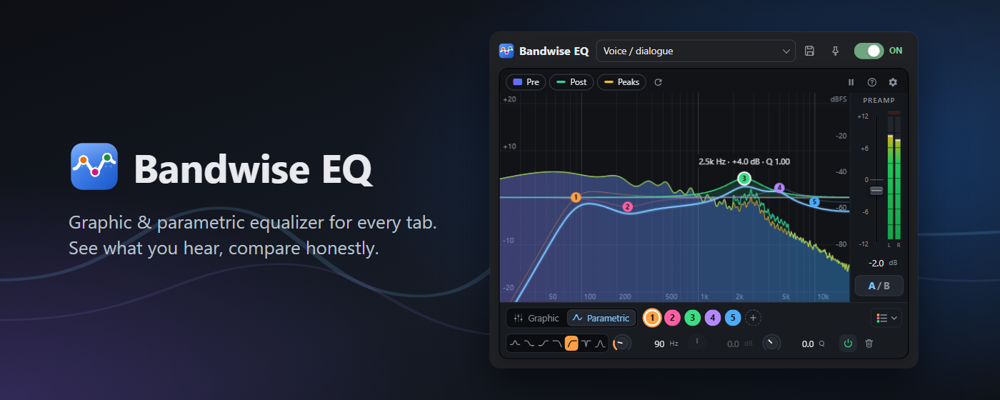

# Bandwise EQ

**An equalizer for every ear** — a graphic and parametric equalizer for the audio of any Chrome tab, with a real-time spectrum analyzer, level-matched A/B comparison and AutoEQ headphone profiles.

## Features

- **Graphic mode** — 10 classic sliders (31 Hz – 16 kHz). The filter gains are solved so that the curve passes exactly through the slider values, with no bumps between them.
- **Parametric mode** — up to 10 bands, 7 filter types (bell, low/high shelf, low/high-pass, notch, band-pass), draggable points, knobs and typed values (e.g. `2.5k`). It is the same equalizer: switching modes carries your curve over.
- **Spectrum analyzer** — pre/post spectrum, peak hold, crosshair readout, per-filter curves, stereo output meter with clip indicator; adjustable FFT size, scale, ranges and smoothing.
- **Level-matched A/B** — hold A/B to hear the original; the bypassed sound is volume-matched so you compare the sound, not the loudness. Shift+click locks the bypass.
- **AutoEQ / Equalizer APO** — import and export `ParametricEQ.txt` profiles.
- **Per-tab settings and per-site memory**, built-in and personal presets, preamp fader and output limiter.
- **No extra windows** — the audio engine runs in an offscreen document.
- **Private** — no network access, no analytics, no access to page content. See the [privacy policy](https://balrog994.github.io/bandwise-eq/privacy.html).
- English and Italian.

## Install

- **Chrome Web Store:** coming soon.
- **From source:** clone this repository, open `chrome://extensions`, enable *Developer mode*, click *Load unpacked* and select the repository folder.

Requires Chrome 116 or later.

## How it works

| File | Role |
|---|---|
| `sw.js` | Service worker: gets the tab's media stream (`tabCapture`) and manages the offscreen document. |
| `offscreen.js` | Audio engine (Web Audio): one chain per tab — preamp → filters → limiter, analyzers, meters, level-matched bypass. |
| `eq-common.js` | Shared data model: validation, presets, graphic-EQ solver, mode switching, Equalizer APO import/export. |
| `popup.*`, `ui-controls.js` | User interface: graph, analyzer, knobs, faders, meters. |
| `i18n.js`, `_locales/` | Translations. |

To build the package for the store: `python scripts/build_zip.py` (creates `dist/bandwise-eq-<version>.zip` with only the extension files).

## Feedback

Bug reports and suggestions: [GitHub Issues](https://github.com/Balrog994/bandwise-eq/issues).

## License

[GNU General Public License v3.0](LICENSE).
